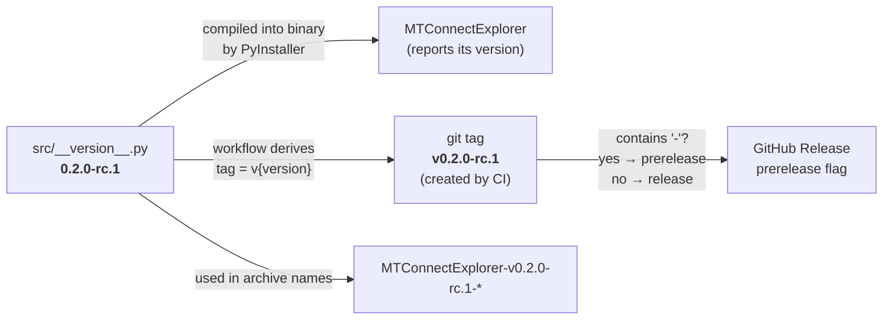
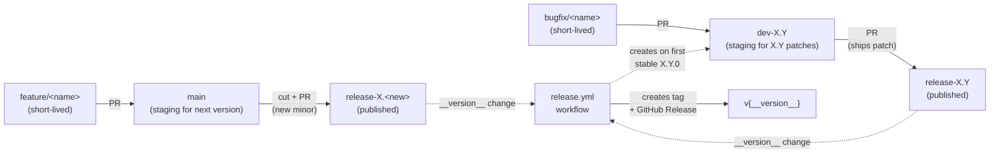
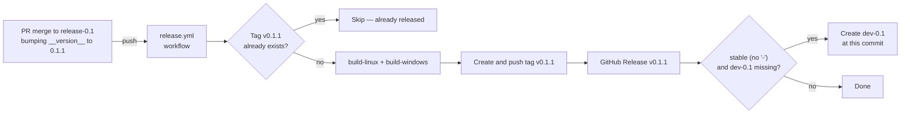
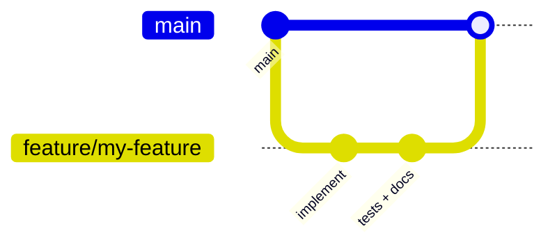
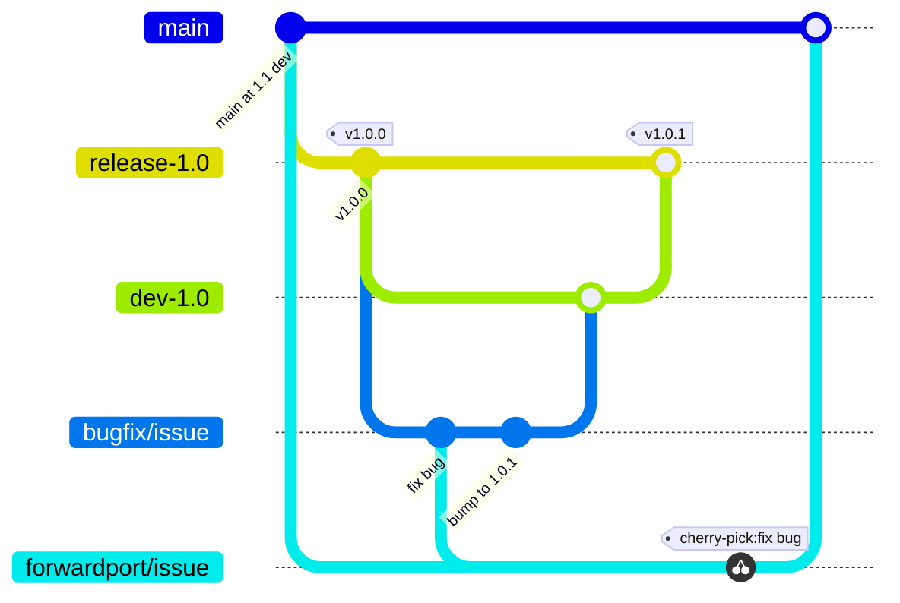

# Contributing

This document describes the branch model, version conventions, release process, and branch
    protection rules for MTConnectExplorer. It's organized by what you're trying to do: start with
    [Overview](#overview) for the mental model, then jump to the section that matches your task:

- [Adding a feature](#adding-a-feature)
- [Creating a bug fix](#creating-a-bug-fix)
- [Creating a new release](#creating-a-new-release)
- [Branch protection rules](#branch-protection-rules)
- [Trade-offs](#trade-offs)


## Overview

### Branch naming conventions

| Branch | Lifetime | Purpose |
|---|---|---|
| `main` | long-lived, protected | Staging area for the next minor release. All new features land here first. |
| `release-X.Y` | long-lived, protected | Published release branch for version line `X.Y`. Pushes that modify `__version__` here trigger the release workflow and ship `vX.Y.Z`. |
| `dev-X.Y` | long-lived, protected | Staging area for `X.Y.x` patches (`X.Y.1`, `X.Y.2`, …). Created automatically by the release workflow when the first stable `X.Y.0` ships. |
| `feature/<short-name>` | short-lived | Feature work, branched off `main`, merged back via PR. |
| `bugfix/<short-name>` | short-lived | Bug fixes for an existing release line, branched off `dev-X.Y`, merged back via PR. |
| `forwardport/<short-name>` | short-lived | Forward-ports a bug fix from `dev-X.Y` to `main`. |

### Version naming conventions

Versions follow [semver](https://semver.org/): `MAJOR.MINOR.PATCH[-PRERELEASE]`.

- `0.2.0-alpha.1` — early prerelease, internal testing
- `0.2.0-beta.1` — feature-complete prerelease, broader testing
- `0.2.0-rc.1` — release candidate, expected to become the stable release
- `0.2.0` — stable release (no suffix)

The `-` suffix is the semver pre-release marker. Any value matching `X.Y.Z-<anything>` produces a
    prerelease on GitHub; a bare `X.Y.Z` produces a stable release.

`__version__` in [`src/__version__.py`](src/__version__.py) is the **single source of truth** —
    there is no second version string to keep in sync. Bumping the file *is* cutting the release.



The value of `__version__` drives:

1. **The application's self-reported version**, baked into the PyInstaller binary (and into Windows
    `.exe` file properties via [`installer.spec`](installer.spec)).
2. **The git tag created by the workflow**, formatted as `v{__version__}`.
3. **The archive filenames** (`MTConnectExplorer-v{__version__}-{platform}.{ext}`).
4. **Whether GitHub marks the release as a prerelease**, determined by whether `__version__`
    contains a `-`.

### Branch flow



Every published release flows through a staging branch (`main` for the next version, `dev-X.Y` for
    older lines) into the corresponding protected `release-*` branch. The push that lands the
    `__version__` change on `release-*` is what triggers the workflow.

### Triggering a release

The workflow fires on **pushes to `release-*` branches that modify `src/__version__.py`**. The path
    filter means non-version commits on a release branch (e.g. dependency bumps, doc fixes) do not
    trigger a release.



Before building, the workflow validates two things:

- **`__version__` is valid semver** (`MAJOR.MINOR.PATCH[-PRERELEASE]`).
- **The branch name matches the version's `X.Y`** — `release-0.1` must hold a `0.1.x` version, not
    `0.2.x`. This catches the "merged the wrong PR into the wrong branch" mistake.

If the tag implied by `__version__` already exists on the remote, the workflow skips (preventing
    re-runs on a non-version commit, or on the same commit being pushed twice). To re-run a release
    — for example if the artifact upload flaked — invoke the workflow manually via the **Run
    workflow** button on the Actions tab, selecting the appropriate `release-X.Y` branch; manual
    runs proceed even when the tag already exists, and the existing GitHub Release is updated in
    place.

After publishing, the workflow creates the line's `dev-X.Y` staging branch if it doesn't already
    exist — but **only for stable releases** (`__version__` without a `-` suffix). It's seeded from
    the just-released commit, so a freshly created `dev-X.Y` is identical to `release-X.Y`.
    Prereleases skip this step, and once `dev-X.Y` exists the workflow never touches it again. For
    this to work, branch protection on `dev-*` must allow the workflow to create branches (see
    [Branch protection rules](#branch-protection-rules)).


## Adding a feature

New features always land on `main` first via a short-lived feature branch. They ship in the next
    minor release.



```bash
git fetch origin
git switch main
git pull --ff-only

# Create a feature branch off main
git switch -c feature/short-description

# ... make changes ...
git add -A
git commit -m "describe the change"

git push -u origin feature/short-description
```

On GitHub, open a PR with **base: `main`** and **compare: `feature/short-description`**. After
    review and merge, delete the feature branch.

The feature is now on `main` but does not appear in any release until either:

- a new minor is cut (see [Creating a new release](#creating-a-new-release)), or
- the feature is forward-ported into an existing `dev-X.Y` branch (uncommon — usually new features
    aren't backported to older lines).


## Creating a bug fix

Bug fixes for an existing released line flow through `dev-X.Y` (staging) → `release-X.Y`
    (published), then are forward-ported to `main` so future minor releases inherit the fix.

Assume `v1.0.0` is shipped, `v1.1.0-rc.1` is in development on `main`, and a bug is found in 1.0.0
    that also exists on `main`.



`dev-1.0` already exists here — the release workflow created it from `release-1.0` when `v1.0.0`
    shipped, so you branch straight off it.

### 1. Create a bugfix branch off `dev-X.Y`

```bash
git fetch origin
git switch dev-1.0
git pull --ff-only

git switch -c bugfix/issue-summary

# ... make the fix ...
# Bump src/__version__.py to "1.0.1" — this is what triggers the release on merge
git add -A
git commit -m "fix: short description, bump to 1.0.1"

git push -u origin bugfix/issue-summary
```

### 2. PR the bugfix into `dev-X.Y`

Open a PR with **base: `dev-1.0`** and **compare: `bugfix/issue-summary`** and merge. Nothing
    ships yet — `dev-X.Y` is staging, not published.

### 3. Forward `dev-X.Y` into `release-X.Y` to ship

On GitHub, open a PR with **base: `release-1.0`** and **compare: `dev-1.0`** and merge. The merge
    brings the `__version__` bump into `release-1.0`, fires the release workflow, and publishes
    `v1.0.1`.

### 4. Forward-port the fix to `main`

If the bug also exists on `main`, cherry-pick the fix commit(s) into a forwardport branch off
    `main`. You want to bring the fix across but **not** the `__version__` bump (`main`'s version
    line is independent of `1.0.x`).

```bash
git fetch origin
git switch main
git pull --ff-only
git switch -c forwardport/issue-summary
```

For a single-commit fix, cherry-pick the SHA:

```bash
git cherry-pick <fix-commit-sha>
```

For multiple fix commits, list them or cherry-pick a range:

```bash
# List individually (oldest first):
git cherry-pick <c1> <c2> <c3>

# Or as a range. `A^..B` means commit A inclusive through commit B inclusive:
git cherry-pick <first-fix>^..<last-fix>

# Or, if `bugfix/issue-summary` is structured as [fix commits...] + [__version__ bump],
# cherry-pick everything new on the bugfix branch except its last commit:
git cherry-pick dev-1.0..bugfix/issue-summary~1
```

Conflicts can surface on any commit in a multi-commit cherry-pick. Resolve files, stage them with
    `git add`, and continue with `git cherry-pick --continue` (or `git cherry-pick --abort` to bail
    entirely).

```bash
git push -u origin forwardport/issue-summary
```

Open a PR with **base: `main`** and **compare: `forwardport/issue-summary`** and merge.

### Reverse direction (fix on `main` first)

If the bug is easier to reproduce on `main`, develop the fix there first, then cherry-pick the fix
    commit onto a bugfix branch off `dev-1.0` (which also bumps `__version__`), and PR into
    `dev-1.0`. Pick whichever direction lets you reproduce and verify the bug most easily.

### Backporting across multiple older lines

If the same bug needs to ship in multiple older lines (e.g. `1.0.x` and `1.1.x`), repeat steps 1–3
    for each `dev-X.Y` independently. Each line needs its own `__version__` bump (`1.0.1` for
    `dev-1.0`, `1.1.1` for `dev-1.1`), so each backport is its own bugfix branch and PR pair.

### Squash-merge alternative

If multi-commit forward-ports become routine, consider configuring `dev-*` to use **Squash and
    merge** for bugfix PRs — every bugfix then lands on the dev branch as a single commit, and
    forward-porting is always a single `git cherry-pick`. Trade-off: the granular history of how
    the fix was built up is collapsed. If you also want to keep the `__version__` bump out of the
    squashed commit, split the bugfix into two PRs (fix-only, then bump).


## Creating a new release

"New release" here means cutting a new minor version (e.g. `1.0` → `1.1`): a new `release-X.Y`
    branch with its initial `X.Y.0` release. Patch releases on an existing line are covered in
    [Creating a bug fix](#creating-a-bug-fix).

The flow is three operations:

1. **Cut the new `release-X.Y` branch** from `main`.
2. **Bump `__version__` on `main`** to the new version.
3. **Forward `main` into `release-X.Y`** to fire the release workflow.

You no longer create `dev-X.Y` by hand. The release workflow creates `dev-X.Y` automatically when
    the **first stable `X.Y.0`** of the line ships, seeded from that released commit (see
    [Triggering a release](#triggering-a-release)). Prereleases (`-rc`, `-beta`, …) don't create it,
    so `dev-X.Y` never lags behind `release-X.Y` at a prerelease commit.

```mermaid
gitGraph
    commit id: "main: 1.0 leading edge"
    branch release-1.1
    checkout main
    commit id: "bump to 1.1.0-rc.1"
    checkout release-1.1
    merge main tag: "v1.1.0-rc.1"
    checkout main
    commit id: "bump to 1.1.0"
    checkout release-1.1
    merge main tag: "v1.1.0"
    branch dev-1.1
    checkout main
    commit id: "next feature"
```

`dev-1.1` above is created by the workflow off `release-1.1` at the `v1.1.0` commit — not by you.

### 1. Cut `release-X.Y` from `main`

```bash
git fetch origin
git switch main
git pull --ff-only

git switch -c release-1.1
git push -u origin release-1.1
```

The branch starts identical to `main`. It won't trigger anything yet — the workflow fires only on
    `__version__` modifications.

### 2. Bump `__version__` on `main`

The bump only needs to land on `main` through a PR — it doesn't matter which branch carries it.
    The release workflow doesn't care where the bump commit came from, and nothing ships until
    `main` is forwarded into `release-X.Y` in step 3. So fold the bump into the **feature branch
    that closes out the release cycle**, keeping it as its own commit:

```bash
git switch feature/short-description     # the last feature of the cycle
# Edit src/__version__.py to "1.1.0-rc.1" (or "1.1.0" if going straight to stable)
git add src/__version__.py
git commit -m "set version to 1.1.0-rc.1"
git push
```

Open a PR with **base: `main`** and **compare: `feature/short-description`** and merge — the
    feature and the bump land on `main` together.

Two things to keep in mind:

- **Keep the `__version__` change as a separate commit** so it stays easy to spot in review and to
    revert on its own, and avoid having two in-flight branches both editing `src/__version__.py` —
    they'll conflict.
- **The rc → stable promotion (`1.1.0-rc.1` → `1.1.0`) is a pure bump with no feature to attach
    it to.** For that step, use a small bump-only branch off `main` (e.g. `bump-version`), since
    there's nothing to fold it into:

    ```bash
    git switch main
    git pull --ff-only
    git switch -c bump-version
    # Edit src/__version__.py to "1.1.0"
    git commit -am "set version to 1.1.0"
    git push -u origin bump-version
    ```

### 3. Forward `main` into `release-X.Y`

No new branch needed — `main` itself is the PR source. On GitHub, open a PR with **base:
    `release-1.1`** and **compare: `main`** and merge. The merge brings the `__version__` bump
    into the release branch, fires the release workflow, and publishes `v1.1.0-rc.1`.

For the rc → stable promotion (`1.1.0-rc.1` → `1.1.0`), repeat steps 2 and 3 with the new version
    (no new release branch needed — it already exists). The stable `v1.1.0` push is what makes the
    workflow create `dev-1.1`.

### One thing to watch

In the window between merging step 2 and merging step 3, any other PRs that land on `main` get
    swept into the release when step 3 merges. If you have unrelated work-in-flight on `main`,
    either hold it until the release lands, or accept that it ships alongside the version bump.
    There's no mechanism in this model to take *only* the bump while leaving other `main` commits
    behind — when `main` forwards into `release-X.Y`, everything ahead of `release-X.Y` goes with
    it.


## Branch protection rules

The maintainer configures these in **Settings → Branches → Add branch protection rule** (classic
    UI) or **Settings → Rules → Rulesets** (newer ruleset UI). Configure one rule for `main`, one
    for the `dev-*` pattern, and one for the `release-*` pattern.

### Rule for `main`

| Setting | Value | Notes |
|---|---|---|
| Require a pull request before merging | **on** | No direct pushes. |
| Require approvals | **on**, 1+ | Set higher if the team is larger. |
| Dismiss stale pull request approvals when new commits are pushed | **on** | Recommended. |
| Require status checks to pass before merging | **on** | A PR can't merge until **all** required checks are green. Mark `build-linux` and `build-windows` (from the CI workflow) required — see note below. |
| Require branches to be up to date before merging | optional | Trades merge cleanliness for friction. |
| Require linear history | **on** (recommended) | Prevents merge commits, keeps `git log` readable. |
| Restrict who can push to matching branches | **on** | Locks down direct pushes; PR-only. |
| Allow force pushes | **off** | |
| Allow deletions | **off** | |
| Do not allow bypassing the above settings | preference | Disabling bypass means admins also go through PRs. |

### Rule for `dev-*` (pattern: `dev-*`)

Same as `main` — `dev-X.Y` serves the same function (a long-lived, protected staging area), just
    for older version lines instead of the latest.

With one exception: the release workflow **creates** `dev-X.Y` automatically on the first stable
    release of each line (see [Triggering a release](#triggering-a-release)). Keep **Restrict branch
    creation** *off* for the `dev-*` pattern, and if you turn on **Restrict who can push to matching
    branches**, add the GitHub Actions bot (`github-actions[bot]`, or your Actions app) to the
    allowed list — otherwise the workflow's branch-creation push is rejected and no `dev-X.Y`
    appears. The bot only ever *creates* `dev-X.Y`; it never pushes to an existing one, so this
    doesn't open a direct-push path around the PR requirement.

### Rule for `release-*` (pattern: `release-*`)

Same as `main`, with these adjustments to consider:

| Setting | Value | Notes |
|---|---|---|
| Require approvals | **on**, consider 2+ | Merging here ships a release. |
| Restrict who can dismiss reviews | **on** | Optional but helpful for release branches. |
| Restrict branch creation | **off** | Must stay off, otherwise you can't create new `release-X.Y` branches. |

### Tag protection

Do **not** add tag protection rules for `v*` unless you explicitly exempt GitHub Actions. The
    release workflow pushes tags using the default `GITHUB_TOKEN`; tag protection that doesn't
    exempt it will cause the workflow's tag push step to fail. Tags created by `GITHUB_TOKEN` are
    already audit-logged, so additional protection is rarely needed at this scale.

### Workflow permissions

The release workflow needs to push tags and to create the `dev-X.Y` branch. The default
    `GITHUB_TOKEN` already has `contents: write` (set in
    [`.github/workflows/release.yml`](.github/workflows/release.yml) under `permissions:`), which
    covers both. Tag protection is the only branch-protection concern for the tag push (tags aren't
    branches); the `dev-X.Y` push is subject to the `dev-*` rule, hence the branch-creation note
    above.

If you've globally restricted workflow token permissions under **Settings → Actions → General →
    Workflow permissions**, make sure "Read and write permissions" is selected, or alternatively
    that the per-workflow `permissions: contents: write` override is honored.

### Pre-merge build check (`ci.yml`)

[`.github/workflows/ci.yml`](.github/workflows/ci.yml) runs on **`pull_request` events targeting
    `main`, `dev-*`, and `release-*`**. It builds the app on both shipped platforms (`build-linux`
    via `make`, `build-windows` via `build.bat ci`) and fails if the binary isn't produced —
    catching build, packaging, and import breakage *before* a PR merges. It does **not** package or
    upload artifacts, and it doesn't run the integration loopback test in
    [`src/test.py`](src/test.py).

To enforce it, mark **`build-linux`** and **`build-windows`** as required status checks under each
    branch rule (**Require status checks to pass before merging**). The check names appear in the
    rule's search box after the workflow has run at least once on a PR.

### Should the release workflow itself be a required status check?

No — the release workflow runs **after** the PR merges (its trigger is the resulting push to
    `release-*`), so it can't be a pre-merge requirement. That's exactly why build validation lives
    in the separate `ci.yml` above, which runs at `pull_request` time.


## Trade-offs

The branch model described above was chosen deliberately, and it isn't the only model the
    underlying tooling supports. This section records what was traded away, what to watch for as
    signs the choice is no longer working, and what it would take to switch.

### What this model costs

**Staging branches sweep in everything ahead of the release branch when they forward.** This
    applies symmetrically to `main → release-latest` and `dev-X.Y → release-X.Y`:

- Anything merged to the staging branch between a `__version__` bump and the forward-to-release PR
    ships with that release. There's no way to take *just* the bump.
- Discipline is required: between bumping `__version__` and forwarding to the release branch, the
    staging branch should be in a shippable state.

**Two long-lived branches per active release line.** Each `X.Y` line that's still receiving
    patches needs both `release-X.Y` and `dev-X.Y`. The branch list grows by 2 per active line,
    not 1.

**`__version__` lives in two places per active line.** `dev-X.Y`'s `__version__` is whatever the
    next patch will be (e.g. `1.0.1` after `1.0.0` shipped); `release-X.Y`'s `__version__` is
    whatever was last released (e.g. `1.0.0`). These intentionally drift between releases.

**`main`'s `__version__` is the leading edge of the version line**, not a `-dev` placeholder. This
    can be unintuitive for contributors used to "main is the next development version."

In exchange you get:

- **A symmetric model.** Every release line has a staging branch (`main` for latest, `dev-X.Y` for
    older). New contributors learn one pattern, then apply it to both fresh features and back-line
    patches.
- **Independent patch development.** Older-line patches happen on `dev-X.Y` without touching
    `main`. Multiple lines can receive patches concurrently without coordinating through `main`.
- **A clear single-version-per-staging-branch invariant.** `main`'s `__version__` always answers
    "what's about to ship next on the latest line"; `dev-X.Y`'s `__version__` always answers
    "what's about to ship next on the X.Y line."

### Alternative: no `dev-X.Y` (hotfixes directly off `release-X.Y`)

A simpler model is to skip `dev-X.Y` entirely. Hotfix branches go directly off `release-X.Y`,
    PR'd into `release-X.Y` with the version bump included. Reconsider if:

- The branch list noise (two long-lived branches per active line) is more friction than the
    symmetry is worth.
- Older lines rarely receive patches, so `dev-X.Y` mostly sits unused.
- You prefer a single one-step hotfix flow over a two-step "PR into dev, then forward into
    release".

### Alternative: per-release-branch version bumps (no staging at all)

The most decentralized model: every release (initial and patch) is bumped on a short-lived branch
    off `release-X.Y`, PR'd into `release-X.Y` directly. `main` holds a `-dev` placeholder rather
    than the leading edge of the version line. Reconsider if:

- You frequently hold feature PRs out of `main` solely to keep them out of an in-flight release —
    that's a sign the staging model is fighting you.
- Readers and new contributors keep expecting `main` to be a `-dev` value.

Trade-off: no more sweep-in risk (the bump *is* the merge), at the cost of more short-lived
    release-cutting branches and a less informative `main`.

### How to switch between models

The switch is mostly process and documentation — the tooling is already agnostic:

| Component | Change needed |
|---|---|
| [`.github/workflows/release.yml`](.github/workflows/release.yml) | **Minimal.** Validation (semver + branch/version match) is model-agnostic and doesn't care which branch the bump came from. The only model-specific piece is the final step that auto-creates `dev-X.Y` on stable releases — drop that step if you move to a model without `dev-X.Y`. |
| [`installer.spec`](installer.spec) | **None.** Reads `__version__.py` at build time, source-agnostic. |
| Branch protection rules | Add/remove the `dev-*` rule depending on whether `dev-X.Y` is in use. No other changes. |
| This document | The relevant sections ([Creating a new release](#creating-a-new-release) and [Creating a bug fix](#creating-a-bug-fix)) are rewritten to reflect the new flow. |
| Process / team comms | Maintainers need to know which model is in play. One-time announcement; no per-release ceremony change beyond where bump commits land. |

The switch is reversible in either direction. The previous git history will straddle the change,
    and that's fine — just be consistent going forward from whenever the switch is made.
