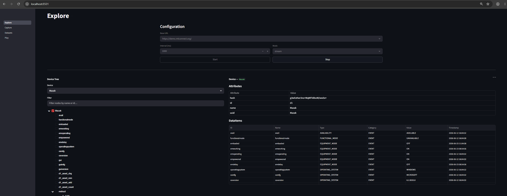
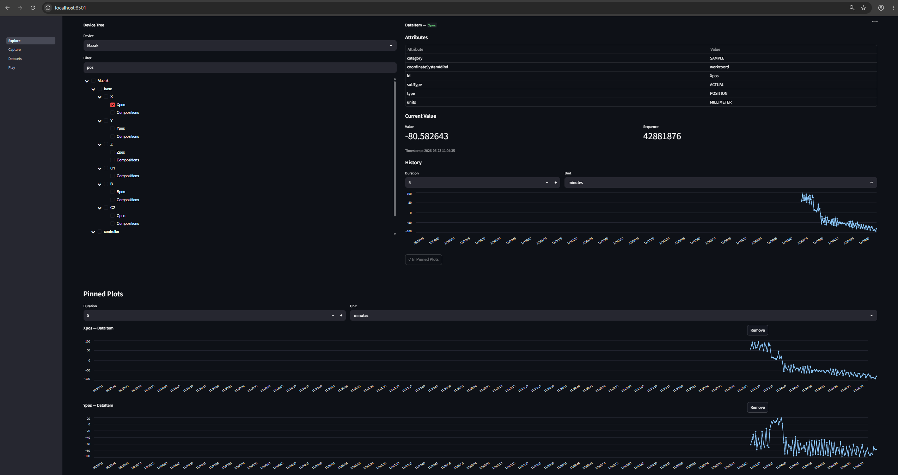
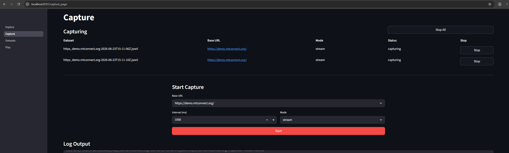
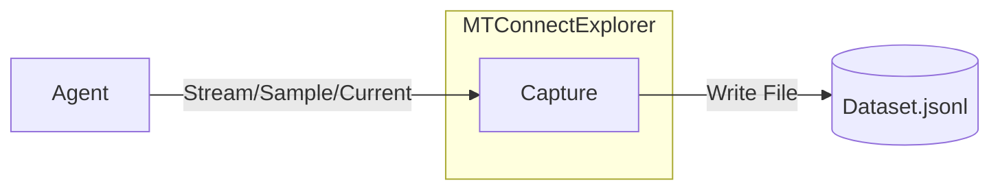
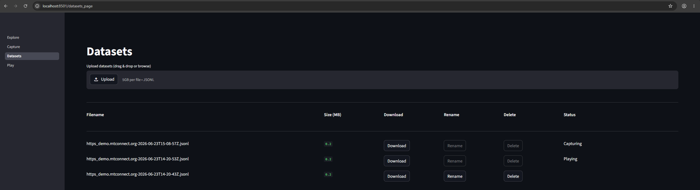
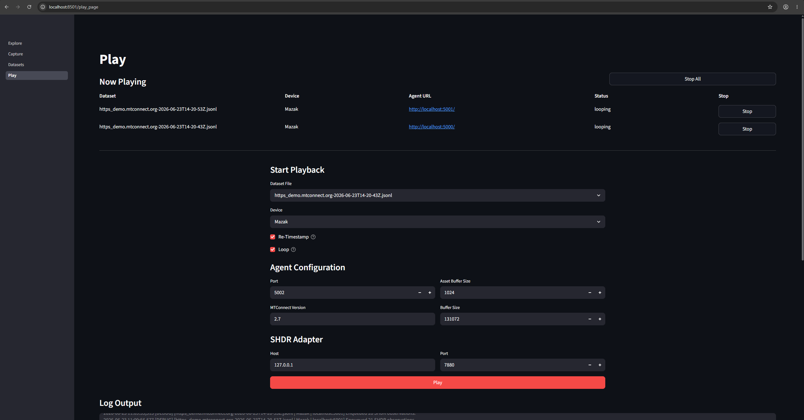
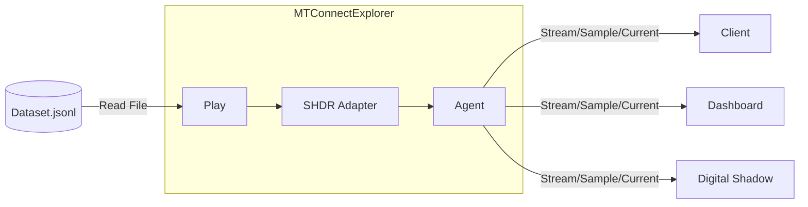

# MTConnectExplorer


> [!CAUTION]
> This application is an early stage prototype. Use with caution.


MTConnectExplorer is a utility for:

1. Viewing the data provided by an [MTConnect Agent](https://github.com/mtconnect/cppagent).
1. Capturing and replaying streaming data using the [Testbed as a Service (TaaS)](https://github.com/m-r-mccormick/Testbed-as-a-Service) method (tailored for MTConnect), empowering the remote development of downstream application such as digital shadows.
1. The collaborative identification and remedy of interoperability issues.

This utility uses the [Testbed as a Service (TaaS)](https://github.com/m-r-mccormick/Testbed-as-a-Service) method for capturing and replaying streaming datasets.
If using this utility in support of an academic publication, please cite [this](https://doi.org/10.1016/j.mfglet.2025.06.155) paper since this utility utilizes the proposed method:

```bibtex
@article{mccormick-2025-testbed-as-a,
  author = {M. R. McCormick and Thorsten Wuest},
  title = {Testbed as a Service (TaaS): a scalable ecosystem for smart manufacturing and industry 4.0 collaboration},
  journal = {Manufacturing Letters},
  volume = {44},
  pages = {1357-1368},
  year = {2025},
  note = {53rd SME North American Manufacturing Research Conference (NAMRC 53)},
  issn = {2213-8463},
  doi = {https://doi.org/10.1016/j.mfglet.2025.06.155},
  url = {https://www.sciencedirect.com/science/article/pii/S2213846325001890},
}
```

The strategy employed by this utility for the collaborative identification and remedy of interoperability issues was
    devised in response to challenges encountered during [this case study](https://ieeexplore.ieee.org/document/11069294).
If you are using this utility in support of an academic publication, please consider citing [this case study](https://ieeexplore.ieee.org/document/11069294) if apppropriate:

```bibtex
@article{mccormick-2025-machine-tool-interoperability,
  author = {M. R. McCormick and Mohammed Shafae and Thorsten Wuest},
  title = {Machine Tool Interoperability in Smart Manufacturing and Industry 4.0},
  journal = {IEEE Access},
  year = {2025},
  volume = {13},
  number = {},
  pages = {117867-117913},
  doi = {10.1109/ACCESS.2025.3585766},
  url = {https://ieeexplore.ieee.org/document/11069294}
}
```


## Explore

The `Explore` page allows you to view the data available from a MTConnect agent.






## Capture

The `Capture` page allows you to capture data from an MTConnect agent (e.g., [https://demo.mtconnect.org/](https://demo.mtconnect.org/)) and save it to a `.jsonl` dataset file.






### Dataset Format

Datasets are in `.jsonl` (`json` Lines) format where each individual line is a `json` object. The required fields are:

| Name | Description |
|---|---|
| RawMTConnect-v0.1 | A required header that identifies the dataset schema and version for future backwards compatibility. |
| TIMESTAMP | The time that the `json` line/object was written the the file. This is also the playhead when replaying captured datasets. |
| ID | This value must always be `MtConnectClientFrame` for `RawMTConnect-v0.1`. |
| PAYLOAD | A `MtConnectClientFrame` `json` object which contains information about a MTConnect request and the associated response. |

The TaaS method normally uses the `ID` field to uniquely identify distinct streams in a dataset, such as MQTT topics
or OPC UA tag IDs/paths. For `RawMTConnect-v0.1` specifically, this is a constant value.

```jsonl
RawMTConnect-v0.1
{"TIMESTAMP": "2027-01-01T00:00:01.000+00:00", "ID": "MtConnectClientFrame", "PAYLOAD": { ... }}
{"TIMESTAMP": "2027-01-01T00:00:02.000+00:00", "ID": "MtConnectClientFrame", "PAYLOAD": { ... }}
{"TIMESTAMP": "2027-01-01T00:00:03.000+00:00", "ID": "MtConnectClientFrame", "PAYLOAD": { ... }}
{"TIMESTAMP": "2027-01-01T00:00:04.000+00:00", "ID": "MtConnectClientFrame", "PAYLOAD": { ... }}
```

### Payload/MtConnectClientFrame Format

A `MtConnectClientFrame` which is the `PAYLOAD` object in a dataset line contains information about a MTConnect request
and the associated response to that request.

| Name | Description |
|---|---|
| timestamp | The timestamp of when the response to the request was received. This may be different than the dataset `TIMESTAMP`. |
| type | The request type, which can be `probe`, `current`, or `sample`. |
| parameters | The parameters of the request, which are different depending on the `type`. |
| url | The url of the request. |
| response | A string containing the entire XML response returned in response to the request. (Empty string if an exception was raised/thrown.) |
| exception | A description of the exception that was raised/thrown during the request, if an exception was raised/thrown. |

The structure of a `MtConnectClientFrame` ensures that the request parameters and the resulting response are fully captured.
If an end user is encountering issues using a MTConnect agent, this structure allows the end user to capture data from a
    MTConnect agent and send that data to a subject matter expert who can analyze the requests and responses to aid in
    diagnosing the cause of the issue and proposing solutions.
This method was devised during challenges encountered in [this case study](https://ieeexplore.ieee.org/document/11069294).

The first frame in a dataset **MUST** be a `probe` type. This is because a `probe` response enumerates devices and
    what data they provide, which is required for `current` and `sample` responses to be parsed.

```json
// A probe request which returns a MTConnectDevices XML document.
"PAYLOAD": {
    "timestamp": "2027-01-01T00:00:01.000+00:00",
    "type": "probe",
    "parameters": {
        "device": null
    },
    "url": "https://demo.mtconnect.org/probe",
    "response": "...<MTConnectDevices>...</MTConnectDevices>...",
    "exception": null
}
// A current request which returns a MTConnectStreams XML document.
"PAYLOAD": {
    "timestamp": "2027-01-01T00:00:02.000+00:00",
    "type": "current",
    "parameters": {
        "path": null,
        "at": null,
        "device": null
    },
    "url": "https://demo.mtconnect.org/current",
    "response": "...<MTConnectStreams>...</MTConnectStreams>...",
    "exception": null
}
// A sample request which returns a MTConnectStreams XML document.
"PAYLOAD": {
    "timestamp": "2027-01-01T00:00:03.000+00:00",
    "type": "sample",
    "parameters": {
        "path": null,
        "from": 32365919,
        "count": null,
        "interval": 1000,
        "device": null
    },
    "url": "https://demo.mtconnect.org/sample?from=32365919&interval=1000",
    "response": "...<MTConnectStreams>...</MTConnectStreams>...",
    "exception": null
}
```

### Capture Mode

There are multiple modes for capturing data from an MTConnect agent.

**Stream**

This mode uses a long-lived streaming `sample` request, effectively 'subscribing' to all Agent data. Using this
    method, after establishing a streaming connection, the Agent continuously sends changes to the value of `dataItem`s
    to the client which instantiated the connection until the client detaches from the stream.

1. Execute a `probe` request to acquire device models.
1. Execute a `current` request to acquire the current value of all `dataItem`s and the `nextSequence`.
1. Execute a `sample` request with a specified `nextSequence` and `interval`, and parse continuously streameing `MTConnectStreams` responses.

**Sample**

This mode uses polling `sample` requests, repeatedly acquiring the value of `dataItem`s in the Agent's buffer that have
    changed since the last request as made.

1. Execute a `probe` request to acquire device models.
1. Execute a `current` request to acquire the current value of all `dataItem`s and the `nextSequence`.
1. Execute a `sample` request with a specified `nextSequence`, and parse the `nextSequence` from the response.
1. Repeat the last step every `interval` (configurable) milliseconds to continuously acquire `dataItem`s that have changed since the last request.

**Current**

This mode uses polling `current` requests, repeatedly acquiring the current value of all `dataItem`s.

1. Execute a `probe` request to acquire device models.
1. Execute a `current` request to acquire the current value of all `dataItem`s.
1. Repeat the last step every `interval` (configurable) milliseconds to continuously acquire the current value of all `dataItem`s.

**Key Distinction**

`current` requests provide a snapshot of machine state at the instant that the request was made. As a result, the `current`
mode may not capture all data. For example, if `current` requests are made every second, and a `dataItem`'s value
changes to another value then changes back to the original value in the time between current requests being made,
the change in value will not be identified.

However, `sample` requests (`stream` and `sample` modes) identify all changes in `dataItem` values.
As a result, `stream` and `sample` modes are recommended to ensure that all changes are identified and captured.
While `stream` mode is generally recommended, `sample` is an alternative if an Agent does not support `stream` mode,
    and `current` is an alternative (with limitations) if an Agent does not support `sample` mode.

The recommended modes in order of priority are:

1. `stream` mode (Recommended)
1. `sample` mode
1. `current` mode (Not Recommended)


## Datasets

The `Datasets` page allows you to view, upload, download, rename, and delete datasets.



## HTTP API

Everything the backend owns — capture, play, and simulate sessions; datasets;
events/logs; ports; running agents — is drivable over a REST API served by the
same process as the UI (UI at `/`, API at `/api/v1`, interactive docs at
`/api/docs`). The full contract lives in [docs/api.md](docs/api.md).

- **Auth:** send `X-API-Key: <key>` on every request, where `<key>` is the
  `api_key` field in `config.json`. `GET /api/v1/health` needs no key.
- **Bind address:** the server binds `127.0.0.1` by default (this machine
  only); pass `--host 0.0.0.0` to reach it from other machines on your LAN.
  Binding beyond localhost without an `api_key` configured is refused at
  startup (the key gates `/api`; see the warning below about the UI).
- **Events:** `GET /api/v1/events/stream` streams logs and session status
  changes as NDJSON with cursor-based reconnect (see docs/api.md §8).

### Configuration

`config.json` is optional and lives in the working directory (next to the
binary, or the repo root in development). It is parsed as JSONC, so `//` and
`/* */` comments are allowed:

```jsonc
{
    // Logging verbosity: debug, info, warning, error, or critical (default: info).
    "log_level": "info",

    // API key accepted in the X-API-Key header. Required to bind a non-local
    // --host; without it the API is only reachable by the built-in UI.
    "api_key": "replace-with-a-long-random-secret"
}
```

A Python client ships as the `mtconnect-explorer-client` wheel (built from
[lib/](lib/), which is also the home of the API's pydantic schemas):

```python
from mtconnect_explorer_client import ApiClient

client = ApiClient("http://127.0.0.1:8501/api/v1", api_key="<config.json api_key>")
session = client.simulate_start(equipment_type="MILL_3AXIS", device_name="Mill")
for event in client.events_stream(scope="simulate"):
    print(event)
```

## Play

The `Play` page allows you to play a `.jsonl` dataset.
When playing a dataset, an instance of the [MTConnect Agent](https://github.com/mtconnect/cppagent), and a SHDR adapter
    are automatically created and started.




